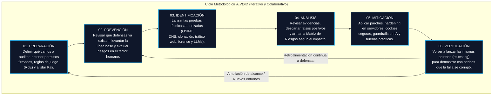
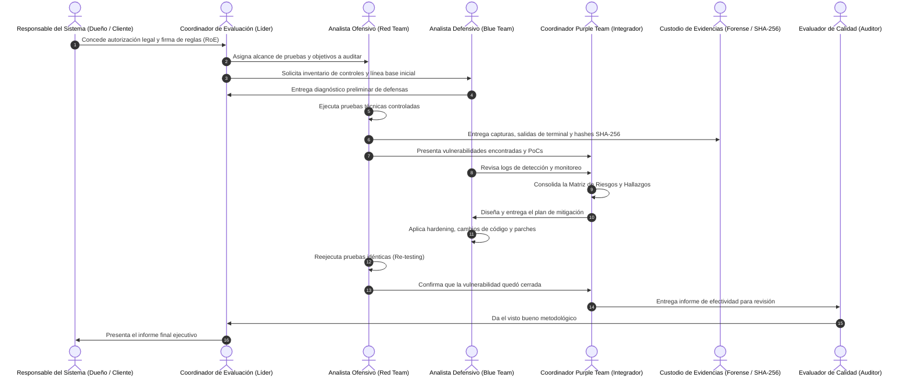

# ÆVØID — Framework Metodológico de Ciberseguridad
> **Metodología para la Evaluación, Análisis y Fortalecimiento de la Seguridad Informática**  
> **Versión:** 1.3.0 (Versión consolidada con 11 laboratorios)  
> **Fecha:** Noviembre de 2026  
> **Institución:** Universidad Santo Tomás — Seccional Tunja  
> **Facultad:** Ingeniería de Sistemas (8° Semestre)  
> **Espacio Académico:** Ciberseguridad White Hat & Blue Team Strategies  
> **Docente:** Sergio Arley Puerto Moreno  

---

### Integrantes del Proyecto (Equipo ÆVØID)
* **Maryori Brigith Barrera Ascanio**
* **Cristian Emanuel Hernández Araque**
* **Johan Sebastian Jurado Hernández**
* **Julián Andrés Roa Lizcano**
* **Andrés José Rozo Castellanos**

---

## 1. ¿Por qué creamos ÆVØID? (Nuestra Visión como Estudiantes)

Como estudiantes de octavo semestre de Ingeniería de Sistemas, a lo largo de la carrera siempre nos han enseñado que la seguridad informática es vital. Sin embargo, cuando uno llega a la práctica real se encuentra con un problema común: **las cosas se hacen de forma muy desordenada**. 

Muchas veces la gente se enfoca únicamente en la parte ofensiva (hacer escaneos con herramientas automáticas, lanzar comandos en Kali Linux o buscar vulnerabilidades para ver qué se rompe), pero esos resultados se quedan en el aire: no se documenta bien la evidencia, no se mide el impacto real para el negocio y rara vez se hace un seguimiento con el equipo que defiende para parchar la falla. En otras ocasiones, el equipo defensivo monta controles o firewalls a ciegas, sin haber comprobado antes si de verdad resisten un ataque.

Para resolver esa desconexión creamos **ÆVØID**. 

El objetivo de nuestro framework no es inventar la rueda ni enredarnos en burocracia teórica inútil, sino construir una **guía metodológica clara, práctica y repetible** que conecte el ataque (**Red Team**), la defensa (**Blue Team**) y la mejora continua (**Purple Team**). Con **ÆVØID**, cada prueba técnica que realizamos tiene una razón de ser, una evidencia verificable (mediante hashes SHA-256) y un plan de mitigación concreto.

---

## 2. Las 6 Fases del Ciclo de Vida de ÆVØID

El corazón de nuestro framework es un ciclo iterativo de **seis (6) fases ordenadas**. No pasamos a la siguiente fase sin haber cerrado y validado la anterior:



1. **Fase 01 - Preparación:** Nada de ataques sorpresa ni pruebas a lo loco. Primero definimos el alcance técnico, los límites legales (Reglas de Compromiso / RoE) y preparamos nuestro entorno de trabajo.
2. **Fase 02 - Prevención:** Antes de atacar, miramos cómo está parado el sistema: qué puertos tiene abiertos, qué políticas de correo maneja y qué tan expuesta está la gente ante engaños.
3. **Fase 03 - Identificación:** La fase donde entran nuestras herramientas técnicas (Burp Suite, Maltego, dig, Steghide, prompts adversariales) de forma controlada para identificar fallas.
4. **Fase 04 - Análisis:** No todo lo que chilla es vulnerabilidad. Aquí depuramos falsos positivos, medimos qué tan grave es cada hallazgo y armamos nuestra matriz de riesgos priorizada.
5. **Fase 05 - Mitigación:** La parte constructiva. Diseñamos e implementamos los parches de código, configuraciones de hardening y guardrails para tapar las brechas encontradas.
6. **Fase 06 - Verificación:** La prueba de fuego. Reejecutamos exactamente las mismas pruebas para comprobar que el parche funcionó y que no rompimos nada más en el camino.

---

## 3. ¿Cómo nos organizamos? (Modelo Purple Team entre Compañeros)

En nuestro equipo de 5 integrantes nos repartimos las responsabilidades para simular cómo opera un departamento de ciberseguridad moderno:



* **Responsable del Sistema (Docente / Entorno Evaluado):** El docente **Sergio Arley Puerto Moreno** como autoridad académica que aprueba el alcance, o la infraestructura institucional y laboratorios controlados (DVWA, PortSwigger, Netlify, Q10) que fijan los límites de prueba.
* **Coordinador de Evaluación & Coordinador Purple Team (Cristian Emanuel Hernández Araque):** Lidera la articulación entre ataque y defensa, coordina los cronogramas de pruebas, integra los entregables técnicos y redacta los informes ejecutivos de cierre.
* **Analista Ofensivo / Red Team Lead (Johan Sebastian Jurado Hernández - ProSebJu):** Responsable de la ejecución de pruebas técnicas intrusivas, explotación en entornos web (DVWA, Netlify, Juice Shop), bypass de validaciones y generación de Pruebas de Concepto (PoC).
* **Analista Defensivo / Blue Team Lead (Andrés José Rozo Castellanos):** Responsable del análisis de infraestructura y superficie de ataque (DNS, MX, SPF, Maltego), escaneos dinámicos DAST (OWASP ZAP) y el diseño de directrices de hardening y contramedidas.
* **Custodio de Evidencias & Especialista Forense (Julián Andrés Roa Lizcano):** Encargado de la cadena de custodia formal, verificación de hashes criptográficos SHA-256, diseño de retos forenses de esteganografía y parametrización de herramientas de escaneo y auditoría web.
* **Evaluadora de Calidad & Auditora Metodológica (Maryori Brigith Barrera Ascanio):** Verifica que cada informe y caso de prueba cumpla con la metodología del framework, valida la reproducibilidad de los pasos técnicos y audita las listas de comprobación de remediación.

---

## 4. Catálogo de los 11 Laboratorios Integrados

Todos los laboratorios desarrollados durante el semestre en la materia fueron estandarizados como instrumentos técnicos formales dentro de **ÆVØID**:

| ID Instrumento | Nombre del Laboratorio | Dominio | Enfoque | Fase Principal |
| :---: | :--- | :---: | :---: | :---: |
| **FC-LAB-001** | Comandos Shell y Gestión de Entornos en Kali Linux | `D01` (Sistemas) | Transversal | 01 Preparación |
| **FC-LAB-002** | DNS Footprinting y Reconocimiento (`nslookup`, `dig`, DNSSEC) | `D02` (OSINT) | Ofensivo | 03 Identificación |
| **FC-LAB-003** | Clonación Web e Inspección de Secretos en Frontend (`HTTrack`) | `D03` (Web) | Ofensivo/Defensivo | 03 Ident. / 04 Análisis |
| **FC-LAB-004** | Análisis Forense Digital y Esteganografía (`Steghide`, `exiftool`) | `D06` (Forense) | Forense / Purple | 03 Ident. / 04 Análisis |
| **FC-LAB-005** | Modelado de Ingeniería Social y Vectores Humanos (Phishing / USB) | `D05` (Humano) | Factor Humano | 02 Prev. / 03 Ident. |
| **FC-LAB-006** | Reconocimiento Pasivo y Mapeo de Infraestructura (`Maltego`) | `D02` (OSINT) | OSINT Pasivo | 03 Identificación |
| **FC-LAB-007** | Interceptación de Login y Análisis Web (`Burp Suite`) | `D03/D04` (Web/APIs) | Web Testing | 03 Ident. / 04 Análisis |
| **FC-LAB-008** | Seguridad en IA y Mitigación de Prompt Injection en LLMs | `D08` (Seguridad IA) | Ofensivo/Defensivo | 03 Ident. / 04 Anál. / 05 Mit. |
| **FC-LAB-009** | Auditoría y Explotación Web en DVWA (SQLi, RCE, XSS, Brute Force) | `D03` (Web) | Ofensivo/Defensivo | 03 Ident. / 04 Anál. / 05 Mit. |
| **FC-LAB-010** | Explotación Avanzada en DVWA (CSRF, RCE vía File Upload, LFI, Blind SQLi) | `D03` (Web) | Ofensivo/Defensivo | 03 Ident. / 04 Anál. / 05 Mit. |
| **FC-LAB-011** | Análisis DAST, Interceptación Proxy y Escaneo con OWASP ZAP | `D03/D04` (Web/APIs) | DAST / Proxy / Purple | 03 Ident. / 04 Anál. / 05 Mit. |

---

## 5. Estructura del Repositorio de GitHub

El repositorio está organizado siguiendo al pie de la letra lo solicitado en la **Sección 11** de la guía del proyecto:

```text
AEVOID-framework/
├── README.md                          # Este documento principal del framework
├── docs/                              # Documentación conceptual
│   ├── framework.md                   # Definición, objetivos y principios rectores
│   ├── arquitectura.md                # Explicación a fondo de las 6 fases del ciclo
│   ├── metodologia.md                 # Procedimiento paso a paso para auditorías
│   ├── repositorio_drive.md           # Enlace y descripción del repositorio en Google Drive
│   └── glosario.md                    # Glosario con los 30 términos técnicos oficiales
├── framework/                         # Artefactos y gobernanza del framework
│   ├── fases.md                       # Entradas, salidas y criterios de cierre de cada fase
│   ├── actores_responsabilidades.md   # Diagrama de interacción y matriz RACI del equipo
│   ├── protocolos.md                  # Reglas de juego (RoE) y cadena de custodia forense
│   └── matrices.md                    # Tablas de cálculo de severidad y niveles de riesgo
├── laboratorios/                      # Fichas técnicas estandarizadas de cada práctica
│   ├── lab-01-shell/                  # FC-LAB-001: Terminal Kali, permisos 700/600 y tuberías
│   ├── lab-02-dns/                    # FC-LAB-002: scanme.nmap.org, dig, nslookup y DNSSEC
│   ├── lab-03-httrack/                # FC-LAB-003: Clonación Netlify, grep y localStorage
│   ├── lab-04-esteganografia/         # FC-LAB-004: DFIR, hashes SHA-256, cadenas y Steghide
│   ├── lab-05-ingenieria-social/      # FC-LAB-005: Escenarios de phishing WhatsApp y USBs
│   ├── lab-06-maltego/                # FC-LAB-006: Grafos OSINT pasivo (Tesla, AWS, Microsoft)
│   ├── lab-07-burp/                   # FC-LAB-007: Interceptación HTTP y anti-enumeración
│   ├── lab-08-prompt-injection/       # FC-LAB-008: OWASP LLM, Guardrails y Human-in-the-Loop
│   ├── lab-09-dvwa/                   # FC-LAB-009: OWASP Top 10 en DVWA (SQLi, RCE, XSS)
│   ├── lab-10-dvwa-avanzado/          # FC-LAB-010: DVWA Avanzado (CSRF, Webshell RCE, LFI, Blind SQLi)
│   └── lab-11-owasp-zap/              # FC-LAB-011: OWASP ZAP (DAST, Proxy Firefox, Spider y Reportes)
├── scripts/                           # Scripts de utilidad (setup_env.sh)
├── plantillas/                        # Plantilla oficial para futuros laboratorios
├── casos-estudio/                     # Caso aplicado y modelado UML de autenticación
│   ├── caso_autenticacion_web.md      # Caso de estudio con diagrama de secuencia integrado
│   ├── diagrama_uml_caso_estudio.md   # Modelado UML completo (Secuencia, Casos de Uso y Actividades)
│   └── diagrama_uml_autenticacion.svg # Gráfico vectorial UML de alta resolución listo para Word
├── resultados/                        # Resultados consolidados
│   ├── matriz_evaluacion_pruebas.md   # Matriz con las 11 pruebas técnicas concluidas (P01-P11)
│   └── indicadores_metricas.md        # Indicadores: 100% de cobertura y severidades
└── anexos/                            # Anexos formales
    ├── anexo_a_matriz_pruebas.md      # Matriz de casos de prueba (CP-01 a CP-20)
    ├── anexo_b_matriz_riesgos.md      # Matriz de hallazgos y riesgos (H-01 a H-16)
    ├── anexo_c_registro_evidencias.md # Catálogo completo de capturas de pantalla (Labs 1 a 11)
    ├── anexo_d_plan_mitigacion.md     # Guía de mitigación y hardening Blue Team
    └── anexo_e_guia_github.md         # Comandos de Git y políticas de publicación
```

---

## 6. Políticas de Publicación en GitHub (Sección 11.2)

1. **Cero Secretos (Zero Secrets):** Nunca subimos contraseñas reales, tokens de Netlify, llaves de API ni credenciales corporativas. Todo se prueba con datos sintéticos y entornos autorizados.
2. **Protección de Datos Personales:** Censuramos correos o datos identificativos de terceros en capturas que involucren portales institucionales (como el SAC de la universidad).
3. **Control de Versiones y Ramas:**
   * La rama `main` guarda únicamente versiones estables que hayan pasado revisión en equipo.
   * Usamos etiquetas semánticas (`v1.0.0`) para marcar entregas consolidadas.

---

## 7. Repositorio Oficial de Evidencias en Google Drive

Dado que las capturas de pantalla Full HD, los informes individuales en formato `.docx` y los archivos consolidados en PDF (como el documento de 63 páginas de Andrés Rozo y el de 37 páginas de Julián Roa) superan las dimensiones prácticas de almacenamiento de un repositorio Git, todo el soporte probatorio original de los cinco (5) integrantes se encuentra almacenado y accesible en:

* **Enlace de Google Drive:** [https://drive.google.com/drive/folders/1l7C8SUD9tOp-fl7noQSQNtzoc9Z6bK56?usp=sharing](https://drive.google.com/drive/folders/1l7C8SUD9tOp-fl7noQSQNtzoc9Z6bK56?usp=sharing)
* **Documento descriptivo detallado:** [docs/repositorio_drive.md](file:///c:/Users/emaha/OneDrive/Desktop/frameworkCyber/AEVOID-framework/docs/repositorio_drive.md)

En este enlace se encuentran organizadas las carpetas de `InformesMaryori`, `ProSebJu` (Sebastian Jurado), los consolidados de Julián Roa y Andrés Rozo, y las carpetas de evidencias crudas clasificadas del Laboratorio 1 al 11.
