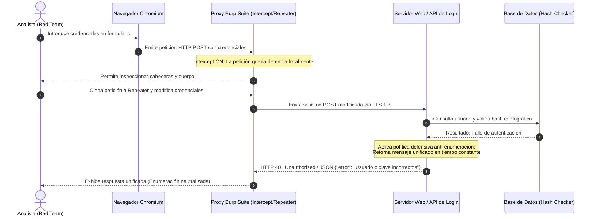

# Caso de Estudio: Análisis Comparativo de Autenticación y Anti-Enumeración

> **Framework de Ciberseguridad ÆVØID**  
> **Universidad Santo Tomás — Seccional Tunja | Ingeniería de Sistemas (8° Semestre)**  
> **Equipo ÆVØID:** Maryori Barrera, Cristian Hernández, Sebastian Jurado, Julian Roa, Andres Rozo  
> **Docente:** Sergio Arley Puerto Moreno  

---

## 1. Introducción y Contexto del Experimento

Dentro de la aplicación práctica de **ÆVØID** (Fase 03 Identificación & Fase 04 Análisis), como equipo nos propusimos evaluar de forma controlada cómo gestionan el inicio de sesión cuatro plataformas web con arquitecturas y tecnologías totalmente diferentes:

1. **OWASP Juice Shop** (Aplicación intencionalmente vulnerable).
2. **UVirtual / Plataforma Q10** (Sistema comercial de gestión académica).
3. **PortSwigger Web Security Academy** (Entorno de entrenamiento con defensas modernas).
4. **SAC — Universidad Santo Tomás** (Sistema de Información Académica institucional).

Utilizamos **Burp Suite** para interceptar las peticiones HTTP/HTTPS, detenerlas antes de que llegaran al servidor, modificar credenciales en la pestaña Repeater y analizar qué tan protegidos están frente a ataques de fuerza bruta y **enumeración de usuarios**.

---

## 2. Tabla Comparativa de Solicitudes y Respuestas

```text
+-----------------------+-----------------------------+-------------------+----------------------------+
| Plataforma            | Endpoint de Login           | Formato de Envío  | Respuesta ante Error       |
+-----------------------+-----------------------------+-------------------+----------------------------+
| OWASP Juice Shop      | /rest/user/login            | JSON plano        | 401 Unauthorized           |
| UVirtual (Q10)        | /Login                      | Form-urlencoded   | JSON {"estado": "error"}   |
| PortSwigger Academy   | /login                      | Form-urlencoded   | INVALID_CREDENTIALS        |
| SAC USTA              | /services/.../fetch/{token} | JSON en Base64    | JSON {"errores": "..."}    |
+-----------------------+-----------------------------+-------------------+----------------------------+
```

---

## 3. Modelado UML: Diagrama de Secuencia de Interceptación y Anti-Enumeración

El siguiente diagrama de secuencia UML modela el ciclo de vida de la petición analizada: desde que el usuario digita las credenciales, pasando por la retención en el proxy Burp Suite y su modificación en Repeater, hasta la respuesta homogénea del backend que neutraliza el ataque de enumeración de usuarios:



> Para consultar el modelo UML completo con **Diagrama de Casos de Uso** y **Diagrama de Actividades**, consulta el documento dedicado: [diagrama_uml_caso_estudio.md](diagrama_uml_caso_estudio.md).

---

## 4. Lecciones Aprendidas por el Equipo de Estudiantes

1. **La regla de oro de los mensajes de error homogéneos:**  
   Descubrimos que ninguna de las cuatro aplicaciones le dice al usuario si falló específicamente el nombre de usuario o la contraseña. Las cuatro devuelven un mensaje genérico (*"Usuario o clave incorrectos"*). Esto es vital: si una plataforma responde *"El usuario no existe"*, un atacante puede automatizar un ataque de diccionario para averiguar qué correos o cédulas válidas existen en la base de datos de la universidad o empresa.
2. **La falsa sensación de seguridad en Base64:**  
   El portal SAC de la USTA incluye un token dinámico en la URL y codifica las credenciales en Base64. Aunque esto evita que alguien que esté detrás de ti mire la clave en la pantalla (*shoulder surfing*), **Base64 no es cifrado**. Cualquier persona con acceso a la red puede decodificarlo al instante con un solo clic en Burp. La verdadera seguridad descansa en la capa de transporte HTTPS (TLS) y en que el backend use algoritmos modernos de hashing (como bcrypt o argon2).
3. **Recomendación Purple Team:**  
   Para plataformas críticas (como las de notas universitarias o bancarias), no basta con pedir usuario y clave: es indispensable habilitar autenticación multifactor (**MFA**) y bloqueo de IPs por tasa de intentos fallidos (**Rate Limiting**).
