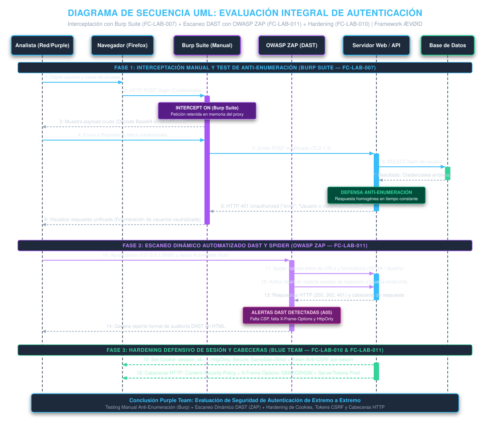

# Caso de Estudio: Análisis Comparativo de Autenticación y Anti-Enumeración

> **Framework de Ciberseguridad ÆVØID**  
> **Universidad Santo Tomás — Seccional Tunja | Ingeniería de Sistemas (8° Semestre)**  
> **Equipo ÆVØID:** Maryori Barrera, Cristian Hernández, Sebastian Jurado, Julian Roa, Andres Rozo  
> **Docente:** Sergio Arley Puerto Moreno  

---

## 1. Introducción y Contexto del Experimento

Dentro de la aplicación práctica de **ÆVØID** (Fase 03 Identificación & Fase 04 Análisis), como equipo nos propusimos evaluar de forma controlada cómo gestionan el inicio de sesión cuatro plataformas web con arquitecturas y tecnologías totalmente diferentes:

1. **OWASP Juice Shop** (Aplicación intencionalmente vulnerable).
2. **UVirtual / Plataforma Q10** (Sistema comercial de gestión académica).
3. **PortSwigger Web Security Academy** (Entorno de entrenamiento con defensas modernas).
4. **SAC — Universidad Santo Tomás** (Sistema de Información Académica institucional).

Este caso de estudio se articula directamente con los instrumentos técnicos **FC-LAB-007 (Interceptación con Burp Suite)** y **FC-LAB-011 (Escaneo DAST con OWASP ZAP)** del catálogo de ÆVØID. Mientras que en el laboratorio 7 utilizamos **Burp Suite** para interceptar manualmente las peticiones HTTP/HTTPS, detenerlas antes de llegar al servidor y alterar credenciales en la pestaña Repeater para analizar la **anti-enumeración de usuarios**, en el laboratorio 11 complementamos el análisis con escaneo dinámico automatizado de formularios de acceso (incluyendo portales en producción como Spotify).

---

## 2. Tabla Comparativa de Solicitudes y Respuestas

```text
+-----------------------+-----------------------------+-------------------+----------------------------+
| Plataforma            | Endpoint de Login           | Formato de Envío  | Respuesta ante Error       |
+-----------------------+-----------------------------+-------------------+----------------------------+
| OWASP Juice Shop      | /rest/user/login            | JSON plano        | 401 Unauthorized           |
| UVirtual (Q10)        | /Login                      | Form-urlencoded   | JSON {"estado": "error"}   |
| PortSwigger Academy   | /login                      | Form-urlencoded   | INVALID_CREDENTIALS        |
| SAC USTA              | /services/.../fetch/{token} | JSON en Base64    | JSON {"errores": "..."}    |
+-----------------------+-----------------------------+-------------------+----------------------------+
```

---

## 3. Modelado UML: Diagrama de Secuencia de Interceptación y Anti-Enumeración

El siguiente diagrama de secuencia UML modela el ciclo de vida completo de la evaluación de seguridad en autenticación: abarca desde la interceptación manual y prueba de anti-enumeración con **Burp Suite** (`FC-LAB-007`), pasando por el escaneo dinámico automatizado y auditoría de cabeceras/cookies con **OWASP ZAP** (`FC-LAB-011`), hasta los controles de hardening aplicados por el Blue Team (`FC-LAB-010`):

```mermaid
sequenceDiagram
    autonumber
    actor RedTeam as Analista (Red/Purple Team)
    participant Browser as Navegador (Firefox)
    participant Burp as Burp Suite (Manual Proxy)
    participant ZAP as OWASP ZAP (DAST/Spider)
    participant Backend as Servidor Web / Auth API (Juice Shop/Q10/SAC/DVWA)
    participant DB as Base de Datos (MySQL/PostgreSQL)

    Note over RedTeam,DB: FASE 1: INTERCEPTACIÓN MANUAL Y ANTI-ENUMERACIÓN (BURP SUITE — FC-LAB-007)
    RedTeam->>Browser: 1: Digita usuario y clave de prueba
    Browser->>Burp: 2: HTTP POST /login (Credenciales según plataforma)
    activate Burp
    Note over Burp: INTERCEPT ON (Burp Suite):<br/>Petición retenida en memoria del proxy
    Burp-->>RedTeam: 3: Muestra payload crudo (Decode Base64 en SAC USTA / JSON en Juice Shop)
    RedTeam->>Burp: 4: Envía a Repeater y altera credenciales (Fuerza bruta controlada)
    Burp->>Backend: 5: Emite POST modificado (TLS 1.3 cifrado)
    activate Backend
    Backend->>DB: 6: SELECT hash seguro
    activate DB
    DB-->>Backend: 7: Resultado: Clave inválida
    deactivate DB
    Note over Backend: DEFENSA ANTI-ENUMERACIÓN:<br/>Respuesta homogénea en tiempo constante
    Backend-->>Burp: 8: HTTP 401 Unauthorized {"error": "Usuario o clave incorrectos"}
    deactivate Backend
    Burp-->>RedTeam: 9: Visualiza respuesta unificada (Enumeración neutralizada en las 4 plataformas)
    deactivate Burp

    Note over RedTeam,DB: FASE 2: ESCANEO DINÁMICO AUTOMATIZADO DAST Y SPIDER (OWASP ZAP — FC-LAB-011)
    RedTeam->>ZAP: 10: Ajusta proxy local (127.0.0.1:8090) y lanza Automated Scan en ZAP
    activate ZAP
    ZAP->>Backend: 11: ZAP Spider rastrea URLs (104 URLs en Q10 · 234 en Testfire · Spotify)
    activate Backend
    ZAP->>Backend: 12: Active Scanner inyecta sondas de ataque (1,509 peticiones HTTP automáticas)
    Backend-->>ZAP: 13: Respuestas HTTP del servidor (200, 302, 401) y captura de cabeceras
    deactivate Backend
    Note over ZAP: ALERTAS DAST DETECTADAS (OWASP A05):<br/>12 Alertas: Falta CSP, Falta X-Frame-Options, HttpOnly ausente
    ZAP-->>RedTeam: 14: Genera reporte formal de auditoría DAST en HTML / XML con métricas consolidadas
    deactivate ZAP

    Note over RedTeam,DB: FASE 3: HARDENING DEFENSIVO DE SESIÓN Y CABECERAS (BLUE TEAM — FC-LAB-010 & FC-LAB-011)
    activate Backend
    Backend-->>Browser: 15: Set-Cookie: session_id=...; HttpOnly; Secure; SameSite=Strict + Token Anti-CSRF por sesión
    Backend-->>Browser: 16: Cabeceras: Content-Security-Policy + X-Frame-Options: SAMEORIGIN + ServerTokens Prod
    deactivate Backend
```

### Gráfico Vectorial UML de Alta Definición
A continuación se presenta la representación visual estandarizada en formato SVG:



> **Nota para entrega de informes:** El archivo vectorial editable se encuentra disponible en [diagrama_uml_autenticacion.svg](diagrama_uml_autenticacion.svg), optimizado para insertarse en Microsoft Word o exportarse a PDF con nitidez vectorial al 100%.  
> Para consultar el modelo UML ampliado con **Diagrama de Casos de Uso** y **Diagrama de Actividades**, consulta el documento dedicado: [diagrama_uml_caso_estudio.md](diagrama_uml_caso_estudio.md).

---

## 4. Lecciones Aprendidas por el Equipo de Estudiantes

1. **La regla de oro de los mensajes de error homogéneos:**  
   Descubrimos que ninguna de las cuatro aplicaciones le dice al usuario si falló específicamente el nombre de usuario o la contraseña. Las cuatro devuelven un mensaje genérico (*"Usuario o clave incorrectos"*). Esto es vital: si una plataforma responde *"El usuario no existe"*, un atacante puede automatizar un ataque de diccionario para averiguar qué correos o cédulas válidas existen en la base de datos de la universidad o empresa.
2. **La falsa sensación de seguridad en Base64:**  
   El portal SAC de la USTA incluye un token dinámico en la URL y codifica las credenciales en Base64. Aunque esto evita que alguien que esté detrás de ti mire la clave en la pantalla (*shoulder surfing*), **Base64 no es cifrado**. Cualquier persona con acceso a la red puede decodificarlo al instante con un solo clic en Burp. La verdadera seguridad descansa en la capa de transporte HTTPS (TLS) y en que el backend use algoritmos modernos de hashing (como bcrypt o argon2).
3. **Recomendación Purple Team:**  
   Para plataformas críticas (como las de notas universitarias o bancarias), no basta con pedir usuario y clave: es indispensable habilitar autenticación multifactor (**MFA**) y bloqueo de IPs por tasa de intentos fallidos (**Rate Limiting**).

---

## 5. Participación del Equipo y Evidencias en Google Drive

Las pruebas de este caso de estudio fueron realizadas y verificadas de manera colaborativa:
* **Julián Andrés Roa Lizcano & Andrés José Rozo Castellanos:** Interceptación manual con Burp Suite y escaneo DAST automatizado con OWASP ZAP (con más de 1,500 peticiones y 12 alertas registradas).
* **Johan Sebastian Jurado Hernández:** Verificación de evasión y payloads en formularios web y réplica en entornos Docker.
* **Maryori Brigith Barrera Ascanio:** Auditoría de respuestas HTTP y validación de listas de chequeo defensivas.
* **Cristian Emanuel Hernández Araque:** Modelado UML, diagramación de secuencias y consolidación de hallazgos.

> 📁 **Evidencias originales:** Las capturas de tráfico HTTP crudo, archivos de proyecto de Burp Suite, reportes HTML exportados de OWASP ZAP y diagramas vectoriales se encuentran en el [Repositorio de Google Drive](https://drive.google.com/drive/folders/1l7C8SUD9tOp-fl7noQSQNtzoc9Z6bK56?usp=sharing).
