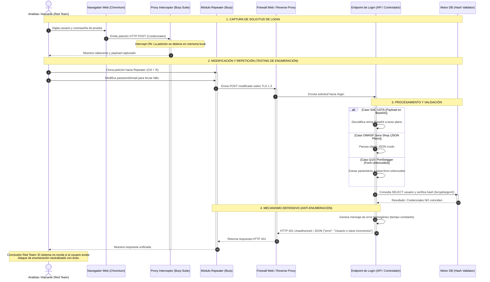
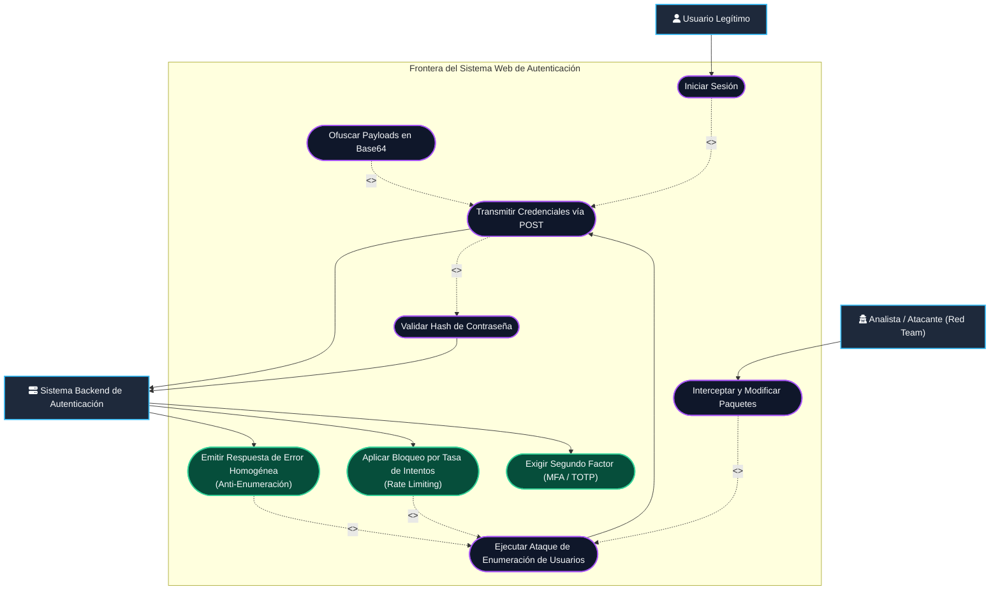
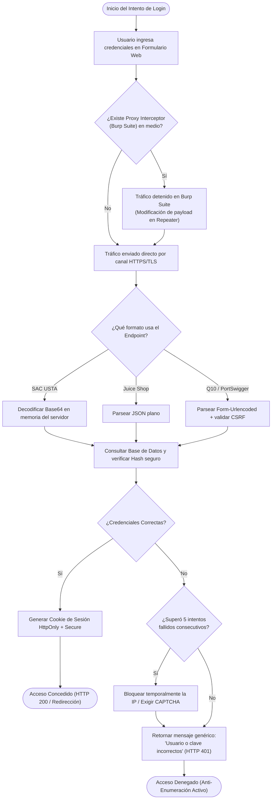

# Modelado UML del Caso de Estudio: Autenticación e Interceptación Web

> **Framework de Ciberseguridad ÆVØID**  
> **Universidad Santo Tomás — Seccional Tunja | Ingeniería de Sistemas (8° Semestre)**  
> **Equipo ÆVØID:** Maryori Barrera, Cristian Hernández, Sebastian Jurado, Julian Roa, Andres Rozo  
> **Docente:** Sergio Arley Puerto Moreno  

Este documento contiene los diagramas formales en notación **UML (Unified Modeling Language)** que modelan el comportamiento, actores, componentes y secuencia técnica del caso de estudio de evaluación de autenticación web y prevención de enumeración de usuarios.

---

## 1. Diagrama de Secuencia UML (Interacción e Interceptación con Burp Suite)

Este diagrama modela el flujo temporal de mensajes entre el analista/atacante, el navegador cliente, el proxy local (**Burp Suite**), el backend de autenticación y la base de datos de credenciales:

---

## 2. Diagrama de Casos de Uso UML (Seguridad en Autenticación)

Este diagrama representa las interacciones de los actores con el sistema, delimitando los casos de uso ofensivos y las contramedidas defensivas:

---

## 3. Diagrama de Actividades UML (Flujo de Decisión en Login)

Muestra el flujo lógico y los puntos de bifurcación de la arquitectura al procesar un intento de acceso:

---

## 4. Conclusiones Metodológicas del Modelado UML

1. **Visibilidad en la Capa de Transporte:** El diagrama de secuencia evidencia que herramientas como Burp Suite operan antes del cifrado del navegador o configurando un certificado CA de confianza, lo que permite modificar el paquete antes de que salga al WAF.
2. **El Valor Defensivo del Mensaje Homogéneo:** En el diagrama de actividades se aprecia que, ya sea que el correo no exista en la BD o que la clave sea errónea, el sistema bifurca hacia la misma caja de respuesta (*"Usuario o clave incorrectos"*). Esto rompe cualquier intento del atacante de enumerar usuarios por diferencias de respuesta.
3. **Ofuscación vs. Cifrado:** En el caso del SAC de la USTA, el diagrama de secuencia resalta que la decodificación de Base64 se realiza en el backend con una operación trivial; por lo tanto, no sustituye al protocolo TLS ni a las políticas de contraseñas seguras.
