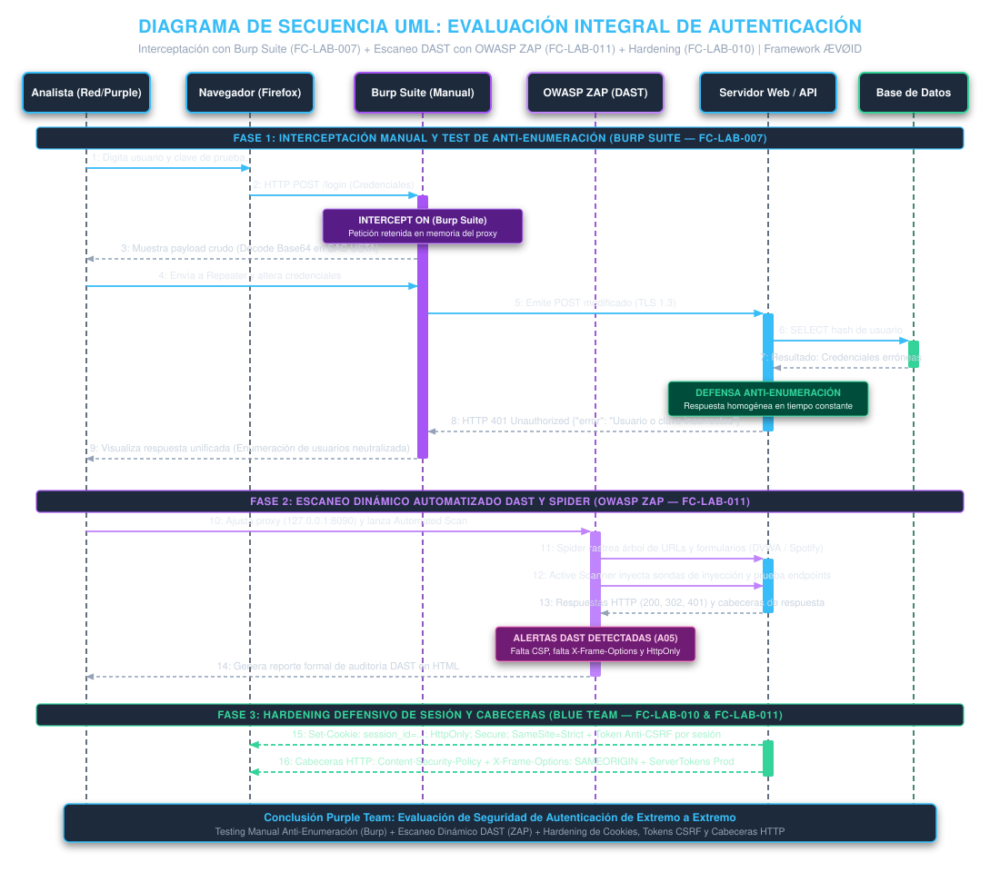
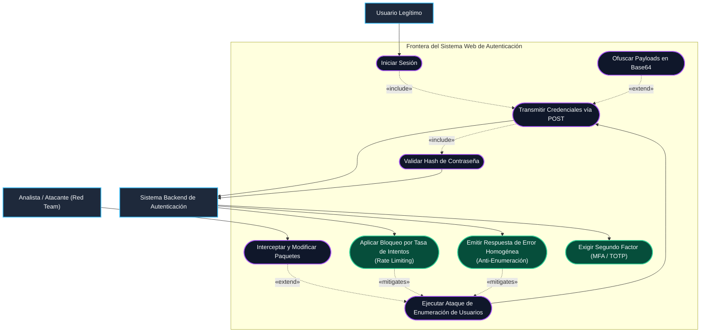
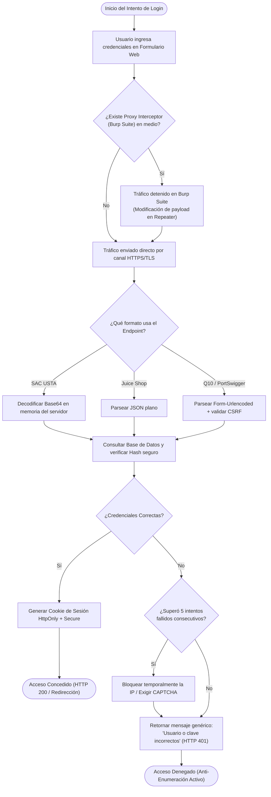

# Modelado UML del Caso de Estudio: Autenticación e Interceptación Web

> **Framework de Ciberseguridad ÆVØID**  
> **Universidad Santo Tomás — Seccional Tunja | Ingeniería de Sistemas (8° Semestre)**  
> **Equipo ÆVØID:** Maryori Barrera, Cristian Hernández, Sebastian Jurado, Julian Roa, Andres Rozo  
> **Docente:** Sergio Arley Puerto Moreno  

Este documento contiene los diagramas formales en notación **UML (Unified Modeling Language)** que modelan el comportamiento, actores, componentes y secuencia técnica del caso de estudio de evaluación de autenticación web y prevención de enumeración de usuarios.

---

## 1. Diagrama de Secuencia UML (Interacción e Interceptación con Burp Suite)

Este diagrama modela el flujo temporal de mensajes entre el analista/atacante, el navegador cliente, el proxy local (**Burp Suite**), el backend de autenticación y la base de datos de credenciales:

### Gráfico Vectorial de Secuencia (SVG de Alta Resolución)


> **Nota:** Puedes abrir o copiar el archivo vectorial listo para exportar a Word o PDF desde [diagrama_uml_autenticacion.svg](diagrama_uml_autenticacion.svg).

### Código Fuente en Notación Mermaid
```mermaid
sequenceDiagram
    autonumber
    actor RedTeam as Analista (Red/Purple Team)
    participant Browser as Navegador (Firefox)
    participant Burp as Burp Suite (Manual Proxy)
    participant ZAP as OWASP ZAP (DAST/Spider)
    participant Backend as Servidor Web / Auth API
    participant DB as Base de Datos

    Note over RedTeam,DB: FASE 1: INTERCEPTACIÓN MANUAL Y ANTI-ENUMERACIÓN (BURP SUITE — FC-LAB-007)
    RedTeam->>Browser: 1: Digita usuario y clave de prueba
    Browser->>Burp: 2: HTTP POST /login (Credenciales)
    activate Burp
    Note over Burp: INTERCEPT ON (Burp Suite):<br/>Petición retenida en memoria del proxy
    Burp-->>RedTeam: 3: Muestra payload crudo (Decode Base64 en SAC USTA)
    RedTeam->>Burp: 4: Envía a Repeater y altera credenciales
    Burp->>Backend: 5: Emite POST modificado (TLS 1.3)
    activate Backend
    Backend->>DB: 6: SELECT hash de usuario
    activate DB
    DB-->>Backend: 7: Resultado: Credenciales erróneas
    deactivate DB
    Note over Backend: DEFENSA ANTI-ENUMERACIÓN:<br/>Respuesta homogénea en tiempo constante
    Backend-->>Burp: 8: HTTP 401 Unauthorized {"error": "Usuario o clave incorrectos"}
    deactivate Backend
    Burp-->>RedTeam: 9: Confirma respuesta unificada (Enumeración neutralizada)
    deactivate Burp

    Note over RedTeam,DB: FASE 2: ESCANEO DINÁMICO AUTOMATIZADO DAST Y SPIDER (OWASP ZAP — FC-LAB-011)
    RedTeam->>ZAP: 10: Ajusta proxy (127.0.0.1:8090) y lanza Automated Scan
    activate ZAP
    ZAP->>Backend: 11: Spider rastrea árbol de URLs y formularios (DVWA / Spotify)
    activate Backend
    ZAP->>Backend: 12: Active Scanner inyecta sondas de inyección y prueba endpoints
    Backend-->>ZAP: 13: Respuestas HTTP (200, 302, 401) y cabeceras
    deactivate Backend
    Note over ZAP: ALERTAS DAST DETECTADAS (A05):<br/>Falta CSP, falta X-Frame-Options y HttpOnly
    ZAP-->>RedTeam: 14: Genera reporte formal de auditoría DAST en HTML
    deactivate ZAP

    Note over RedTeam,DB: FASE 3: HARDENING DEFENSIVO DE SESIÓN Y CABECERAS (BLUE TEAM — FC-LAB-010 & FC-LAB-011)
    activate Backend
    Backend-->>Browser: 15: Set-Cookie: session_id=...; HttpOnly; Secure; SameSite=Strict + Token Anti-CSRF
    Backend-->>Browser: 16: Cabeceras: Content-Security-Policy + X-Frame-Options: SAMEORIGIN + ServerTokens Prod
    deactivate Backend
```

---

## 2. Diagrama de Casos de Uso UML (Seguridad en Autenticación)

Este diagrama representa las interacciones de los actores con el sistema, delimitando los casos de uso ofensivos y las contramedidas defensivas:



---

## 3. Diagrama de Actividades UML (Flujo de Decisión en Login)

Muestra el flujo lógico y los puntos de bifurcación de la arquitectura al procesar un intento de acceso:



---

## 4. Conclusiones Metodológicas del Modelado UML

1. **Visibilidad en la Capa de Transporte:** El diagrama de secuencia evidencia que herramientas como Burp Suite operan antes del cifrado del navegador o configurando un certificado CA de confianza, lo que permite modificar el paquete antes de que salga al WAF.
2. **El Valor Defensivo del Mensaje Homogéneo:** En el diagrama de actividades se aprecia que, ya sea que el correo no exista en la BD o que la clave sea errónea, el sistema bifurca hacia la misma caja de respuesta (*"Usuario o clave incorrectos"*). Esto rompe cualquier intento del atacante de enumerar usuarios por diferencias de respuesta.
3. **Ofuscación vs. Cifrado:** En el caso del SAC de la USTA, el diagrama de secuencia resalta que la decodificación de Base64 se realiza en el backend con una operación trivial; por lo tanto, no sustituye al protocolo TLS ni a las políticas de contraseñas seguras.
