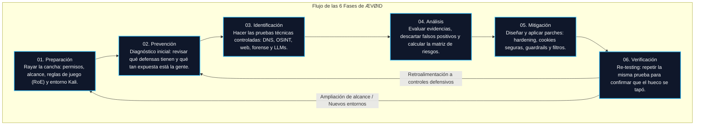

# Arquitectura Metodológica de ÆVØID

> **Framework de Ciberseguridad ÆVØID**  
> **Universidad Santo Tomás — Seccional Tunja | Ingeniería de Sistemas (8° Semestre)**  
> **Materia:** Ciberseguridad White Hat & Blue Team Strategies  
> **Integrantes:** Maryori Barrera, Cristian Hernández, Sebastian Jurado, Julian Roa, Andres Rozo  
> **Docente:** Sergio Arley Puerto Moreno  

---

## 1. ¿Cómo funciona la arquitectura de ÆVØID?

Cuando empezamos a plantear este framework en el grupo, nos dimos cuenta de que evaluar la seguridad de un sistema no es simplemente llegar con Kali Linux y disparar comandos a ver qué sale. Si uno no sigue un orden, se pierden evidencias, se pueden tumbar servicios sin querer y al final el cliente o el profesor no entiende qué fue lo que se encontró ni cómo solucionarlo.

Por eso diseñamos la arquitectura de **ÆVØID** en **seis (6) fases continuas e iterativas**. Decimos que es iterativa porque la seguridad nunca termina: cuando llegas a la fase de verificación y compruebas que un parche funciona, esa información se devuelve para mejorar la línea base y estar preparados ante nuevas amenazas.

---

## 2. Detalle de las 6 Fases: Entradas, Actividades y Entregables

### Fase 01: Preparación
* **De qué trata:** Es la base legal y técnica. Antes de tocar cualquier teclado, necesitamos autorización expresa. En ciberseguridad la diferencia entre un delito y una auditoría ética es un papel firmado.
* **Entradas:** Petición de la auditoría, lista preliminar de IPs o dominios a evaluar y contactos del equipo técnico del cliente.
* **Qué hacemos:** Definimos las Reglas de Compromiso (*Rules of Engagement - RoE*), horarios permitidos para pruebas, IPs autorizadas desde donde atacaremos y alistamos nuestras máquinas virtuales en Kali Linux con permisos estrictos (`chmod 700 / 600`).
* **Salidas:** Plan de auditoría firmado, lista de activos autorizados y criterios de parada de emergencia.
* **Criterio de cierre:** Documento de autorización firmado por el dueño del sistema. Sin firma, no se arranca.

### Fase 02: Prevención
* **De qué trata:** Ver cómo está la casa antes de entrar. Evaluamos la postura defensiva inicial y la concientización de las personas.
* **Entradas:** Arquitectura de red, inventario de tecnologías conocidas y políticas de seguridad actuales.
* **Qué hacemos:** Revisamos qué controles ya están puestos (firewalls, registros SPF en DNS, antivirus), medimos la línea base y analizamos qué tan vulnerable es el personal frente a ingeniería social (phishing por WhatsApp, memorias USB botadas).
* **Salidas:** Documento de línea base y diagnóstico inicial.
* **Criterio de cierre:** Diagnóstico aprobado por el Analista Defensivo y el Coordinador del equipo.

### Fase 03: Identificación
* **De qué trata:** La fase práctica y técnica. Aquí es donde ponemos a prueba el sistema utilizando nuestros laboratorios e instrumentos.
* **Entradas:** Alcance aprobado y herramientas listas (Burp Suite, Maltego, dig, HTTrack, Steghide, prompts adversariales).
* **Qué hacemos:** 
  * Reconocimiento pasivo en fuentes abiertas con Maltego (`FC-LAB-006`).
  * Consultas DNS con `dig` y `nslookup` buscando fallas de configuración y falta de DNSSEC (`FC-LAB-002`).
  * Clonación web con HTTrack para revisar fuga de información o almacenamiento inseguro en frontend (`FC-LAB-003`).
  * Interceptación de tráfico web con Burp Suite para probar logins y control de accesos (`FC-LAB-007`).
  * Análisis forense de archivos multimedia para detectar canales encubiertos o datos alterados (`FC-LAB-004`).
  * Pruebas de escape semántico e inyección de prompts en sistemas de IA (`FC-LAB-008`).
* **Salidas:** Bitácora de comandos ejecutados, capturas de pantalla de hallazgos y paquete de evidencias selladas con su hash SHA-256.
* **Criterio de cierre:** Evidencias entregadas al Custodio con cadena de custodia intacta.

### Fase 04: Análisis
* **De qué trata:** Darle sentido a los datos. No nos quedamos con la salida cruda de una herramienta; nos sentamos a analizar si el hallazgo es real o un falso positivo, y qué tanto le dolería a la organización si alguien lo explota.
* **Entradas:** Registros de las pruebas, evidencias y respuestas del servidor.
* **Qué hacemos:** Evaluamos la probabilidad y el impacto de cada falla. Con eso calculamos la severidad (Baja, Media, Alta o Crítica) y armamos la Matriz de Riesgos.
* **Salidas:** Matriz de Hallazgos y Riesgos priorizada.
* **Criterio de cierre:** Matriz revisada y consensuada entre quien atacó (Red Team) y quien defiende (Blue Team).

### Fase 05: Mitigación
* **De qué trata:** Solucionar las cosas. No sirve de nada encontrar diez vulnerabilidades si no ayudamos a corregirlas.
* **Entradas:** Matriz de riesgos con los puntos críticos identificados.
* **Qué hacemos:** Diseñamos y aplicamos soluciones reales:
  * Firmar zonas DNS con DNSSEC y ajustar registros SPF a directivas estrictas (`-all`).
  * Quitar variables sensibles de `localStorage` y usar cookies seguras (`HttpOnly`, `Secure`, `SameSite`).
  * Implementar respuestas genéricas en los logins para evitar que adivinen usuarios válidos (anti-enumeración).
  * Montar guardrails deterministas en el backend (NeMo / Pydantic) y confirmación humana (*Human-in-the-Loop*) para acciones críticas en aplicaciones con IA.
* **Salidas:** Registro de cambios aplicados, parches de código y guías de hardening.
* **Criterio de cierre:** Parches desplegados y confirmados por los administradores.

### Fase 06: Verificación
* **De qué trata:** Comprobar con pruebas reales que el hueco quedó tapado y que el sistema sigue funcionando.
* **Entradas:** Sistema mitigado y casos de prueba originales de la Fase 03.
* **Qué hacemos:** Volvemos a lanzar exactamente el mismo comando o petición que antes funcionaba para demostrar que ahora es bloqueado o respondido correctamente (Re-testing).
* **Salidas:** Informe Final de Efectividad con las métricas del ciclo (100% de cobertura y tasa de remediación).
* **Criterio de cierre:** Validación final firmada por el Evaluador y entrega formal al cliente.
