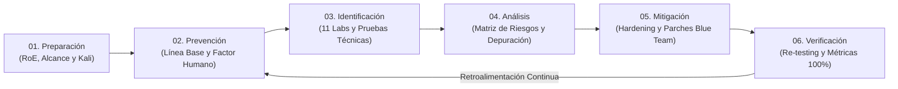

# Guía Metodológica de Operación — Framework ÆVØID

> **Framework de Ciberseguridad ÆVØID**  
> **Universidad Santo Tomás — Seccional Tunja | Ingeniería de Sistemas (8° Semestre)**  
> **Espacio Académico:** Ciberseguridad White Hat & Blue Team Strategies  
> **Equipo ÆVØID:** Maryori Barrera, Cristian Hernández, Sebastian Jurado, Julian Roa, Andres Rozo  
> **Docente:** Sergio Arley Puerto Moreno  
> **Versión:** 1.3.0 (Noviembre 2026)

---

## 1. ¿Cómo se Aplica ÆVØID en una Evaluación Real?

Como estudiantes de Ingeniería de Sistemas, diseñamos la metodología de **ÆVØID** pensando en resolver el problema más habitual en ciberseguridad: **el desorden en las pruebas y la falta de seguimiento entre el ataque y la defensa**. 

Nuestra metodología establece un flujo de trabajo disciplinado, repetible y colaborativo dividido en **seis (6) fases secuenciales e iterativas**. Cada fase tiene requisitos de entrada indispensables, actividades técnicas estandarizadas, artefactos de salida obligatorios y criterios formales de cierre que deben cumplirse antes de avanzar a la siguiente etapa.

---

## 2. Procedimiento Operativo Paso a Paso (Las 6 Fases)

### Fase 01: Preparación (Rayar la Cancha)
* **Paso 1.1 — Delimitación del Alcance:** Identificar exactamente qué servidores, dominios, rangos de IP, repositorios o contenedores están autorizados para prueba (y cuáles están expresamente prohibidos).
* **Paso 1.2 — Firma de Reglas de Compromiso (RoE):** Acordar por escrito ventanas horarias de auditoría, IPs de origen autorizadas y criterios de parada inmediata (*Stop Order*) ante cualquier riesgo de indisponibilidad.
* **Paso 1.3 — Acondicionamiento del Entorno Kali Linux (`FC-LAB-001`):** Ejecutar el script `scripts/setup_env.sh` y aplicar políticas de mínimo privilegio POSIX (`chmod 700 / 600`) sobre las carpetas de evidencias y reportes.
* **Criterio de Cierre:** Documento RoE firmado por el Responsable del Sistema y el Coordinador de Evaluación.

### Fase 02: Prevención (Línea Base y Superficie Externa)
* **Paso 2.1 — Diagnóstico de Línea Base:** Evaluar configuraciones existentes de red, servicios activos y políticas de correo institucional (registros SPF / DKIM / DMARC).
* **Paso 2.2 — Modelado del Factor Humano (`FC-LAB-005`):** Caracterizar vectores de persuasión psicológica, campañas simuladas de phishing académico (WhatsApp / PDFs institucionales) y protocolos físicos frente a memorias USB sospechosas.
* **Criterio de Cierre:** Documento de diagnóstico inicial aprobado por el Analista Defensivo y el Coordinador.

### Fase 03: Identificación (Pruebas Técnicas Controladas)
En esta fase se ejecutan los instrumentos técnicos del catálogo, agrupados por su dominio metodológico:
* **Dominio D02 (OSINT y Red):**
  * Footprinting DNS con `nslookup`, `dig` y comprobación DNSSEC (`FC-LAB-002`).
  * Mapeo pasivo de infraestructura en nube y grafos de relaciones con Maltego (`FC-LAB-006`).
* **Dominio D03 & D04 (Web y Autenticación):**
  * Clonación web con HTTrack e inspección de variables sensibles en frontend (`FC-LAB-003`).
  * Interceptación proxy de peticiones de login con Burp Suite y evaluación anti-enumeración (`FC-LAB-007`).
  * Auditoría web en DVWA: Inyección SQL, Command Injection / RCE, XSS Reflejado y Persistente, y Fuerza Bruta (`FC-LAB-009`).
  * Explotación avanzada en DVWA: Modificación de clave por CSRF, RCE mediante subida de webshell en File Upload, Directory Traversal LFI y Blind SQLi booleana (`FC-LAB-010`).
  * Análisis dinámico DAST automatizado, Spider y auditoría de cabeceras de respuesta con OWASP ZAP (`FC-LAB-011`).
* **Dominio D06 (Forense Digital):**
  * Detección de canales encubiertos, concatenación binaria con `strings` y extracción de secretos con Steghide (`FC-LAB-004`).
* **Dominio D08 (Seguridad en Inteligencia Artificial):**
  * Pruebas adversariales de Prompt Injection, escape semántico y contención de exceso de agencia en LLMs (`FC-LAB-008`).
* **Cadena de Custodia:** Cada captura y archivo generado se sella inmediatamente con su hash criptográfico SHA-256 (`sha256sum`).
* **Criterio de Cierre:** Paquete de evidencias completo entregado al Custodio de Evidencias con hashes verificados.

### Fase 04: Análisis (Dar Sentido a las Evidencias)
* **Paso 4.1 — Depuración de Falsos Positivos:** Descartar alertas espurias (como firmas erróneas de herramientas automáticas o extensiones no aplicables).
* **Paso 4.2 — Estimación de Severidad:** Calcular el nivel de riesgo cruzando la **Probabilidad de Ocurrencia** (1 a 4) con el **Impacto en el Negocio** (1 a 4), asignando categorías: Crítica, Alta, Media, Baja o Informativa.
* **Paso 4.3 — Consolidación de la Matriz:** Estructurar los hallazgos en la Matriz de Riesgos formal (Anexo B).
* **Criterio de Cierre:** Matriz de riesgos consensuada en sesión colaborativa Purple Team entre el Analista Ofensivo y el Analista Defensivo.

### Fase 05: Mitigación (Hardening y Soluciones de Ingeniería)
* **Paso 5.1 — Priorización de Parches:** Atender de forma prioritaria los riesgos Críticos (< 24 horas) y Altos (< 7 días).
* **Paso 5.2 — Aplicación de Controles Blue Team:**
  * Implementar Sentencias Preparadas (PDO) y erradicar llamadas a la shell de Linux (`system()`, `exec()`).
  * Implementar tokens anti-CSRF aleatorios por sesión y directivas `SameSite=Strict`.
  * Configurar listas blancas estrictas de extensiones, comprobación de tipo MIME real y almacenamiento fuera de la raíz web para subidas de archivos.
  * Proteger parámetros de inclusión de rutas mediante whitelists estáticas y funciones canónicas (`basename`, `realpath`).
  * Desplegar cabeceras HTTP defensivas (`Content-Security-Policy`, `X-Frame-Options: SAMEORIGIN`, `X-Content-Type-Options: nosniff`) y suprimir banners del servidor (`ServerTokens Prod`, `expose_php = Off`).
  * Desplegar Guardrails deterministas en backend (NeMo/Pydantic) y confirmación humana (*Human-in-the-Loop*) para sistemas de IA.
* **Criterio de Cierre:** Despliegue de los parches y configuraciones de hardening confirmado por el equipo administrador.

### Fase 06: Verificación (Re-Testing y Medición de Impacto)
* **Paso 6.1 — Reejecución Idéntica (Re-testing):** Repetir exactamente los mismos comandos y peticiones que antes vulneraban el sistema para comprobar que ahora son bloqueados o neutralizados.
* **Paso 6.2 — Comprobación de No Regresión:** Verificar que los controles de seguridad no hayan afectado el funcionamiento ordinario ni la experiencia de los usuarios legítimos.
* **Paso 6.3 — Cálculo de Indicadores:** Medir los KPIs del ciclo: Cobertura de pruebas (100%), Tasa de remediación (100%) y Tasa de descarte de falsos positivos (100%).
* **Criterio de Cierre:** Emisión del Informe Final de Efectividad con visto bueno del Evaluador de Calidad y entrega al Responsable del Sistema.

---

## 3. Matriz de Trazabilidad Integral de los 11 Laboratorios (Sección 11.3)

Siguiendo el mandato de trazabilidad de la guía del proyecto, cada uno de los 11 instrumentos técnicos está articulado con una fase, un dominio, un caso de prueba, un hallazgo de riesgo, su control defensivo y su resultado de verificación:

| Instrumento | Dominio | Fase | Caso de Prueba | Hallazgo Asociado | Control Defensivo Aplicado | Resultado de Verificación |
| :---: | :---: | :---: | :---: | :---: | :--- | :--- |
| **FC-LAB-001** | `D01` | 01 | **CP-01** | Configuración base | Permisos restrictivos POSIX (`chmod 700/600`) | Aprobado (Entorno blindado) |
| **FC-LAB-002** | `D02` | 03 | **CP-02** | **H-01** (DNS sin DNSSEC) | Firma DNSSEC autoritativa (KSK/ZSK) | Aprobado (Mapeo completo) |
| **FC-LAB-003** | `D03` | 03/04 | **CP-03, CP-04** | **H-02** (Inseguridad en frontend) | Erradicar `localStorage`, usar cookies seguras | Aprobado (Réplica en :8080) |
| **FC-LAB-004** | `D06` | 03/04 | **CP-05, CP-06, CP-07** | **H-03** (Exfiltración encubierta) | Pasarelas DLP y re-compresión de imágenes (CDR) | Aprobado (Extracción `confidencial.txt`) |
| **FC-LAB-005** | `D05` | 02/03 | **CP-08** | **H-04** (Ingeniería social) | Concientización, bloqueo USB y canales oficiales | Aprobado (10 factores modelados) |
| **FC-LAB-006** | `D02` | 03 | **CP-09** | **H-05** (Exposición cloud pasiva) | Auditoría a proveedores cloud y ofuscación DNS | Aprobado (Grafo en Tesla/AWS) |
| **FC-LAB-007** | `D03/D04`| 03/04 | **CP-10** | **H-06** (Fuerza bruta y enumeración) | Respuestas unificadas anti-enumeración y MFA | Aprobado (4 plataformas auditadas) |
| **FC-LAB-008** | `D08` | 03/05 | **CP-11, CP-12** | **H-07, H-08** (Prompt Injection e IA) | Guardrails deterministas y Human-in-the-Loop | Aprobado (5 vectores OWASP LLM) |
| **FC-LAB-009** | `D03` | 03/05 | **CP-13, CP-14** | **H-09, H-10** (SQLi, RCE, XSS en DVWA) | Sentencias preparadas PDO, CSP y cookies HttpOnly | Aprobado (Exploit contenido y parchado) |
| **FC-LAB-010** | `D03` | 03/05 | **CP-15, CP-16, CP-17, CP-18** | **H-11, H-12, H-13, H-14** (File Upload, CSRF, LFI) | Whitelist extensiones/MIME, token CSRF, basename | Aprobado (Webshell RCE y LFI neutralizados) |
| **FC-LAB-011** | `D03/D04`| 03/04 | **CP-19, CP-20** | **H-15, H-16** (DAST, Headers y Cookies) | Headers CSP/XFO, cookies flags y DevSecOps CI/CD | Aprobado (Reporte DAST en DVWA/Spotify) |

---

## 4. Conclusión Metodológica

La articulación de estos 11 laboratorios dentro de **ÆVØID** demuestra que una evaluación de ciberseguridad no consiste en lanzar ataques aislados sin propósito. Cada prueba técnica ofensiva ejecutada por el Red Team sirve de insumo para que el Blue Team diseñe controles preventivos reales, y para que el Purple Team certifique, mediante re-evaluaciones objetivas, que la postura de seguridad de la organización es cada vez más sólida y resiliente.
