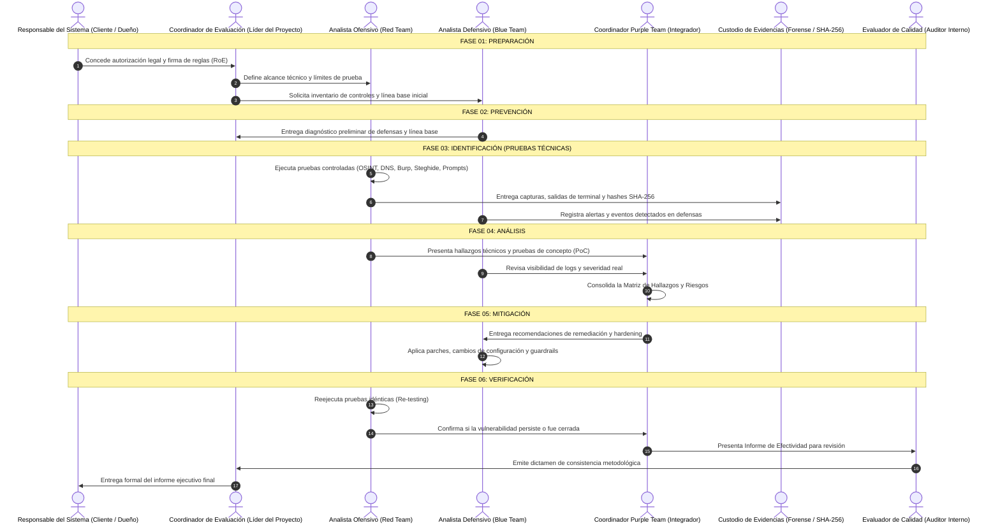

# Modelo de Actores, Responsabilidades e Interacción en ÆVØID

> **Framework de Ciberseguridad ÆVØID**  
> **Universidad Santo Tomás — Seccional Tunja | Ingeniería de Sistemas (8° Semestre)**  
> **Materia:** Ciberseguridad White Hat & Blue Team Strategies  
> **Integrantes:** Maryori Barrera, Cristian Hernández, Sebastian Jurado, Julian Roa, Andres Rozo  
> **Docente:** Sergio Arley Puerto Moreno  

---

## 1. ¿Cómo trabajamos en equipo? (El Enfoque Purple Team)

En proyectos universitarios es muy fácil que uno solo haga todo o que cada quien trabaje por su lado sin hablarse. En **ÆVØID** decidimos adoptar una filosofía **Purple Team**:
* No se trata de que el **Red Team** "se burle" del **Blue Team** porque encontró un hueco de seguridad.
* Tampoco de que el Blue Team culpe al Red Team de romper cosas.
* La idea es que los que atacan y los que defienden trabajen juntos en la misma mesa para que cada prueba se convierta en una mejora real y medible para la organización.

Para simular una estructura profesional de ciberseguridad, definimos **7 roles clave** que nos distribuimos entre los cinco integrantes del grupo:

---

## 2. Descripción de Roles dentro de ÆVØID

| Rol | ¿Qué hace en el proyecto? | Entregable Principal |
| :--- | :--- | :--- |
| **Responsable del Sistema** | Es el dueño del activo o la entidad que nos contrata/autoriza. Define los límites y da el aval legal. | Autorización firmada y Reglas de Compromiso (RoE). |
| **Coordinador de Evaluación** | El líder del equipo. Planifica los tiempos, asigna tareas a los compañeros y asegura que nadie se pase del alcance. | Plan de evaluación y actas de inicio/cierre. |
| **Analista Ofensivo (Red Team)** | El que ejecuta las pruebas técnicas: escaneos DNS, clonación web, interceptación en Burp y ataques de prompt injection. | Bitácora de comandos, PoCs y registros técnicos. |
| **Analista Defensivo (Blue Team)** | El que analiza las alertas, mide la línea base, propone las mitigaciones y aplica parches de hardening. | Diagnóstico de controles, parches y cambios aplicados. |
| **Coordinador Purple Team** | El integrador del grupo. Sienta al Red Team y al Blue Team a dialogar, traduce hallazgos en matrices de riesgo comprensibles. | Matriz de Riesgos y Plan de Mitigación unificado. |
| **Custodio de Evidencias** | El encargado de la cadena de custodia. Calcula los hashes SHA-256 de cada archivo y captura para certificar su autenticidad. | Registro de cadena de custodia y catálogo de hashes. |
| **Evaluador de Calidad** | Hace las veces de auditor interno. Revisa que los informes no tengan errores y que cualquier comando sea 100% reproducible. | Rúbrica de validación metodológica y visto bueno. |

---

## 3. Matriz RACI del Equipo de Trabajo

Para que no queden dudas de quién hace qué en cada fase, nos regimos por esta matriz RACI:

| Fase de ÆVØID | Responsable del Sistema | Coordinador Evaluación | Analista Ofensivo | Analista Defensivo | Coordinador Purple Team | Custodio Evidencias | Evaluador Calidad |
| :--- | :---: | :---: | :---: | :---: | :---: | :---: | :---: |
| **01. Preparación** | **A** | **R** | C | C | C | I | I |
| **02. Prevención** | I | A | I | **R** | C | I | C |
| **03. Identificación** | I | A | **R** | C | C | **R** | I |
| **04. Análisis** | I | A | C | C | **R** | C | C |
| **05. Mitigación** | I | A | I | **R** | C | I | I |
| **06. Verificación** | **I** | **A** | **R** | C | **R** | C | **R** |

* **R (Responsible):** Es quien hace la tarea con las manos en la masa.
* **A (Accountable):** Es quien responde y aprueba que la tarea esté bien hecha.
* **C (Consulted):** Es a quien se le pide opinión o datos técnicos.
* **I (Informed):** Es a quien se le notifica el resultado final.
